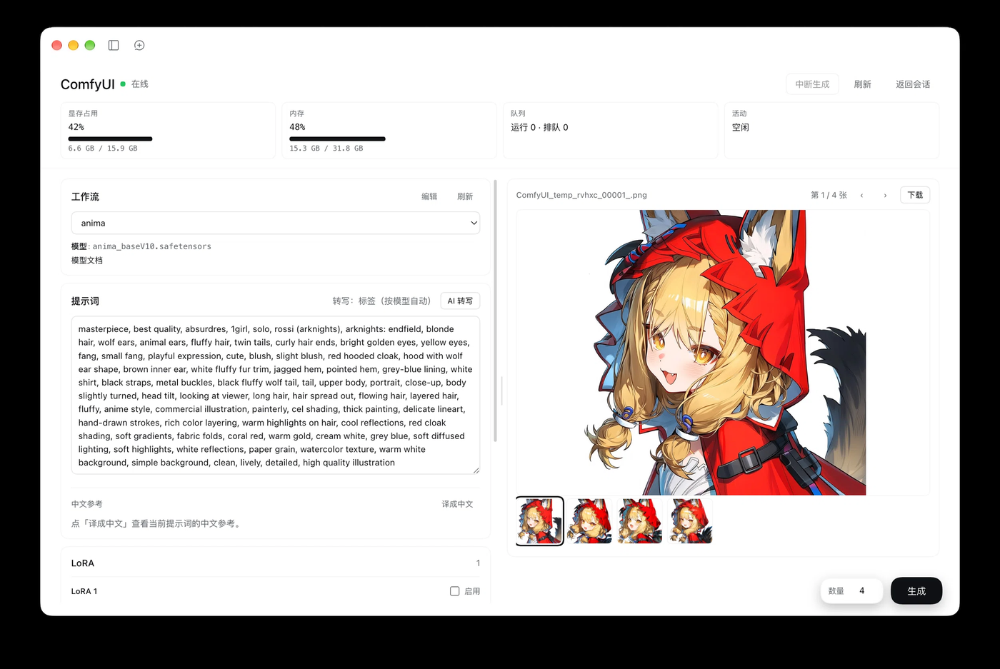
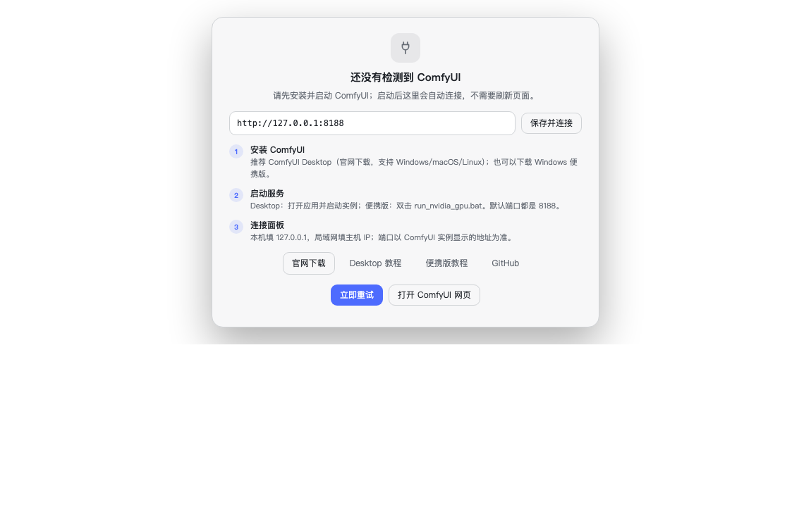
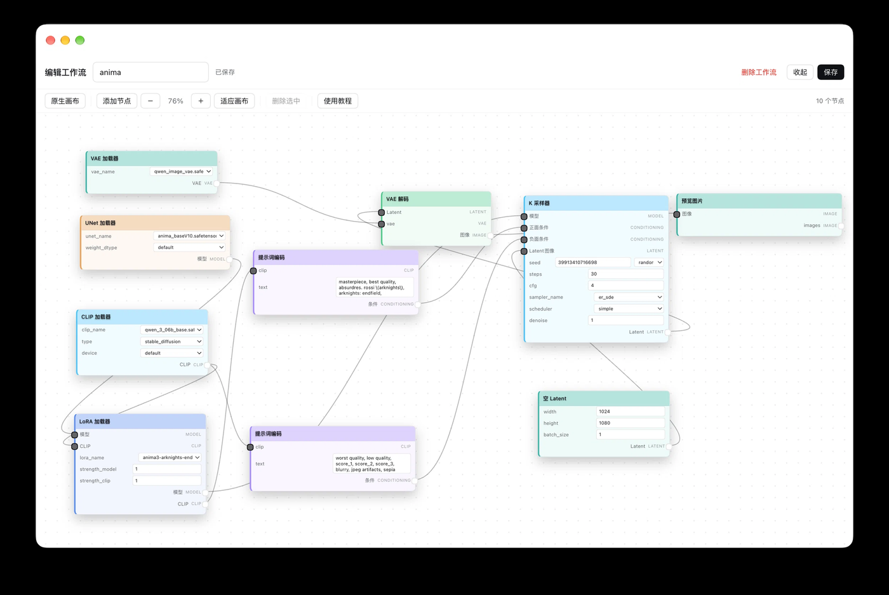
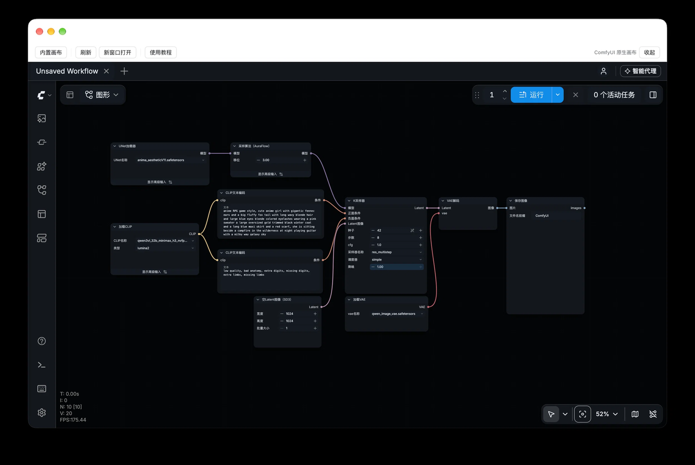
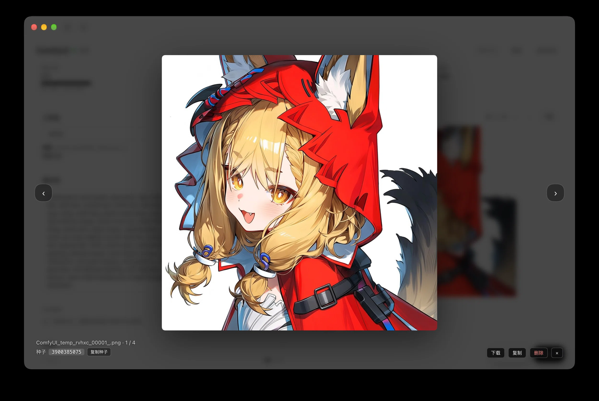

# dsh-comfyui-studio

Operate ComfyUI from the DeepSeek Harness sidebar: pick a saved workflow, write a prompt, generate, inspect results, and edit nodes without switching windows.

[](https://www.npmjs.com/package/dsh-comfyui-studio)
[](https://github.com/xingyeai23/dsh-comfyui-studio/actions/workflows/ci.yml)
[](https://github.com/xingyeai23/dsh-comfyui-studio/blob/main/LICENSE)




## Why

Opening the ComfyUI web page means tab switching, cleaning A1111 parameter dumps and entering the graph to tweak a LoRA. This plugin keeps the common loop in one panel for people who generate SDXL / NoobAI / Anima / Flux images from DSH.

## Features

- **Generate in one panel** — pick a saved image workflow, write a prompt, generate, inspect results.
- **Automatic A1111 cleanup** — Steps / CFG / Sampler dumps are stripped and defaults restored.
- **Asset checks** — missing checkpoints, VAEs and LoRAs are reported with file names and target folders.
- **LoRA quick edit** — choose the file, adjust model / CLIP strength or bypass the node without opening the graph.
- **Built-in node editor** — slide-up canvas with drag, zoom, right-click add / edit / bypass / delete, and save back to ComfyUI.
- **Native canvas** — embed the official ComfyUI web UI when you need the full UI.
- **Full-screen preview** — fade / zoom, prev / next, download, copy to clipboard, remove from results, and show / copy the seed.
- **Live stats** — VRAM, RAM, queue and activity cards, with a real WebSocket queue progress bar.
- **AI prompts** — tag or natural-language rewriting based on the checkpoint, plus a Chinese reference translation.
- **First-run guide** — when ComfyUI is offline, the panel shows install steps, official links and an editable address; it reconnects automatically.

## Quick start

### 1. Install

**npm package: `dsh-comfyui-studio`** ([npm page](https://www.npmjs.com/package/dsh-comfyui-studio))

Recommended inside DSH:

1. Open **Plugins → Discover → Add index source**;
2. Enter:
   ```
   https://raw.githubusercontent.com/xingyeai23/dsh-comfyui-studio/main/plugin-index.json
   ```
3. Install **ComfyUI Studio** (this installs `dsh-comfyui-studio` from npm).

Refresh the page (⌘R). A **ComfyUI** entry appears in the sidebar.

From source: install this directory with `plugin_manager` → `install_bundle`. See [CONTRIBUTING.md](https://github.com/xingyeai23/dsh-comfyui-studio/blob/main/CONTRIBUTING.md).

### 2. Connect

Start ComfyUI:

- **ComfyUI Desktop**: launch an instance; default port `8188`;
- **Windows portable**: run `run_nvidia_gpu.bat`; default port `8188`.

If the address differs, edit it in the input (e.g. `192.168.1.10:8188`) and press **Save and connect**, or press **Scan LAN** to find a server on the same network. The address is remembered and reconnects every 5 seconds.



### 3. First image

Pick a saved image workflow, write a positive prompt (or press **AI rewrite**), then press **Generate**.

Only image-output workflows without subgraphs are listed. If the list is empty, save an image workflow in ComfyUI first.

## Usage

### Node editor

Press **Edit** on the workflow card. The canvas slides up; rename / delete the workflow and save back to `workflows/<name>.json`.

- Drag nodes, drag empty space to pan, wheel to zoom.
- Right-click empty space to add a node; right-click a node to edit / add / bypass / delete; right-click a link to delete it.
- Double-click a node for the inspector (title, widgets, inputs / outputs).
- Nodes are colored by type; `⊘` bypasses; drag ports to connect.
- Unsaved changes prompt **Save and collapse / Discard / Cancel** when closing.
- **Native canvas** switches to the embedded official ComfyUI web UI.



The **Native canvas** button switches to the embedded official ComfyUI page:



### LoRA, params and preview

- **LoRA card**: choose a file, adjust model / CLIP strength, uncheck Enabled to bypass the LoRA node.
- **Params**: steps / CFG, sampler / scheduler, a normal seed input with random / fixed / increment / decrement, and width × height.
- **Preview**: click the result for full screen; Esc / background closes, ← / → navigates, and the seed can be copied. Download, copy as PNG and remove-from-results are in the bottom-right corner.



## Configuration

Defaults to `http://127.0.0.1:8188`. Override in the profile `cordis.patch.yml`:

```yaml
- id: comfyui-panel
  config:
    baseUrl: http://192.168.1.10:8188
    discoveryPort: 8188
    requestTimeoutMs: 8000
    llmProvider: ''
    llmModel: ''
    rewriteMaxTokens: 800
    rewriteReasoningEffort: off
```

The first-run address saved in the panel lives in browser `localStorage` and takes precedence over the profile default. Reload the plugin (or restart DSH) after changing profile config.

## Compatibility

- DeepSeek Harness `>=0.2.2-rc.1`, Node.js `>=20.3`.
- ComfyUI tested with 0.44; uses `/system_stats`, `/object_info`, `/history`, `/userdata/workflows` and `/ws`.
- macOS / Windows / Linux; desktop and web DSH (the host proxies ComfyUI).
- Native canvas needs iframe support; HTTPS DSH with HTTP ComfyUI is blocked by mixed content — use **Open in new window**.

## Privacy

No telemetry or uploads. The plugin talks to your ComfyUI through the local DSH host; AI rewrite / translation sends prompts to the model provider configured in your DSH profile. The embedded native canvas is ComfyUI's own web UI.

## Troubleshooting

See [docs/TROUBLESHOOTING.md](https://github.com/xingyeai23/dsh-comfyui-studio/blob/main/docs/TROUBLESHOOTING.md).

## Development

```bash
node --check lib/client.js
node --test test/*.test.mjs
node scripts/verify.mjs
```

See [CONTRIBUTING.md](https://github.com/xingyeai23/dsh-comfyui-studio/blob/main/CONTRIBUTING.md) for live verification and release steps.

## License

MIT. Community plugin, not an official ComfyUI or DeepSeek Harness project.
