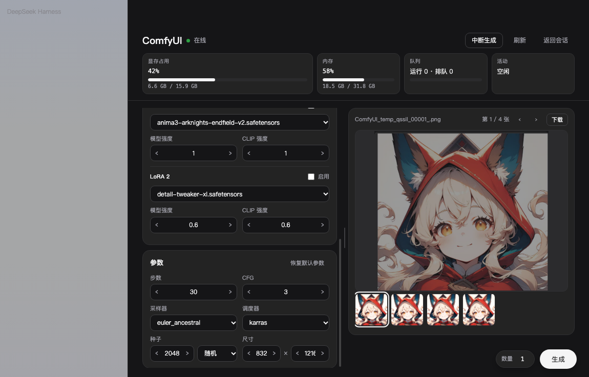
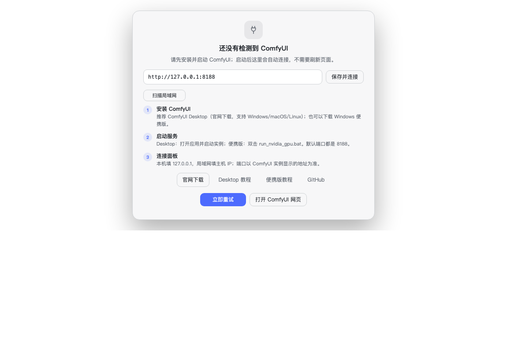
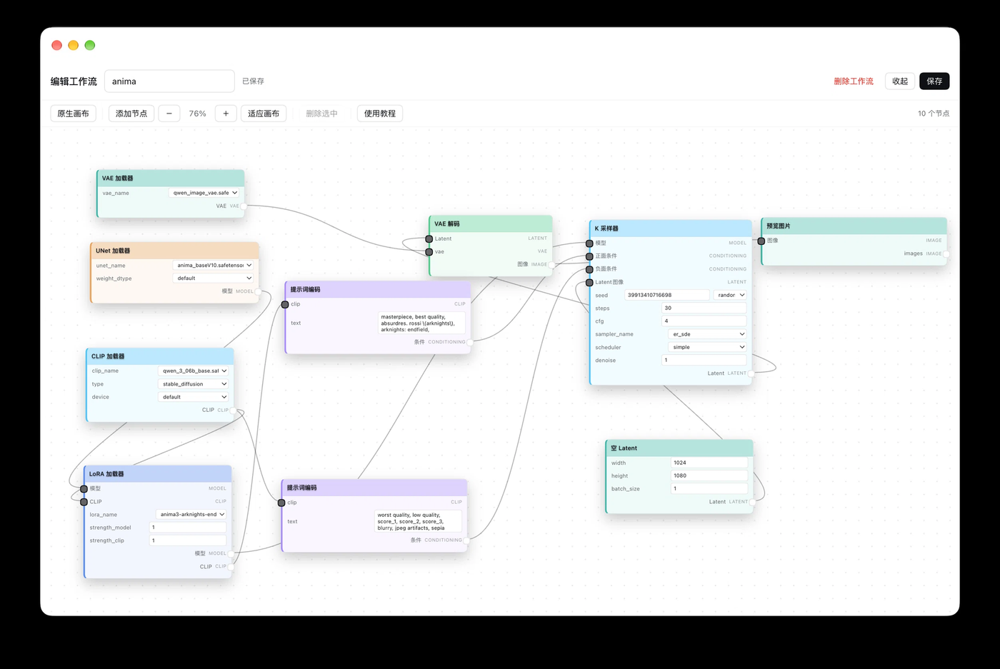
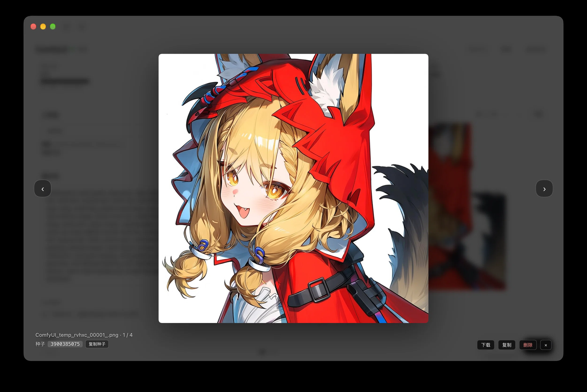

# dsh-comfyui-studio

在 DeepSeek Harness 左侧栏直接操作 ComfyUI：选工作流、写提示词、生成、放大预览、编辑节点，全程不用来回切换窗口。

[](https://www.npmjs.com/package/dsh-comfyui-studio)
[](https://github.com/xingyeai23/dsh-comfyui-studio/actions/workflows/ci.yml)
[](https://github.com/xingyeai23/dsh-comfyui-studio/blob/main/LICENSE)
[](https://www.npmjs.com/package/dsh-comfyui-studio)




## 简介

这是一个把 ComfyUI 工作台搬进 DeepSeek Harness 的插件：在一个侧栏面板里完成挑工作流、写提示词、生成、看结果、调 LoRA 和改节点。

直接开 ComfyUI 网页要来回切标签页，A1111 参数堆要手动清，LoRA 强度要进画布改。这个插件把这些高频操作收进一个面板，适合日常在 DSH 里跑 SDXL / NoobAI / Anima / Flux 出图的人。

## 特性

- **一个面板完成生成**：从已保存的图片工作流里下拉选一个，写提示词，生成，看结果。
- **A1111 参数自动清理**：提示词里混入的 Steps / CFG / Sampler 等参数堆会被清掉，并还原成默认值。
- **缺模型提示到位**：缺 checkpoint / VAE / LoRA 时，资产检查给出具体文件名和目标目录，并禁用生成。
- **LoRA 快捷编辑**：直接选文件、改模型 / CLIP 强度、勾选启用或绕过，不用打开画布。
- **内置节点编辑器**：画布从底部滑出，支持拖动、缩放、右键添加 / 编辑 / 绕过 / 删除节点，以及保存回 ComfyUI。
- **原生画布**：一键内嵌 ComfyUI 官方网页，完整功能都在；切回内置画布即可用简化编辑器。
- **全屏图片预览**：淡入缩放、上一张 / 下一张、下载、复制到剪贴板、从结果列表删除，以及显示和复制生成种子。
- **实时状态**：显存 / 内存 / 队列 / 活动四张卡片，生成时显示 WebSocket 推送的真实队列进度。
- **AI 提示词转写**：按 checkpoint 自动判断标签模型或自然语言模型；中文参考一键翻译。
- **首次使用引导**：连不上时整页显示安装步骤、官方下载链接和地址输入框，地址会记住并自动重连。

## 快速开始

### 1. 安装

**npm 包名：`dsh-comfyui-studio`**（[npm 页面](https://www.npmjs.com/package/dsh-comfyui-studio)）

推荐在 DSH 内安装：

1. 打开 **插件 → 发现**，点击「添加索引源」；
2. 填入插件索引：
   ```
   https://raw.githubusercontent.com/xingyeai23/dsh-comfyui-studio/main/plugin-index.json
   ```
3. 找到「ComfyUI 工作室」并安装（安装的就是 npm 包 `dsh-comfyui-studio`）。

刷新页面（⌘R）后，左侧栏会出现「ComfyUI」入口。

其他安装方式：从源码目录用 `plugin_manager` 的 `install_bundle` 安装；开发与发布流程见 [CONTRIBUTING.md](https://github.com/xingyeai23/dsh-comfyui-studio/blob/main/CONTRIBUTING.md)。

### 2. 首次连接

打开左侧栏「ComfyUI」。先启动 ComfyUI：

- **ComfyUI Desktop**：打开应用并启动实例，默认端口 `8188`；
- **Windows 便携版**：双击 `run_nvidia_gpu.bat`，默认端口 `8188`。

如果地址不一致，直接在输入框里改成正确地址（支持 `192.168.1.10:8188` 写法），点「保存并连接」；也可以点「扫描局域网」自动找同网段的服务。地址保存在浏览器本地，之后每 5 秒自动重连。



### 3. 生成第一张图

选择一个已保存的图片工作流 → 填写正向提示词（可点「AI 转写」）→ 在右下角点「生成」。

> 下拉框只列出 ComfyUI `workflows/` 里**图片输出、且不含子图**的工作流。视频工作流和子图工作流不会出现；如果列表为空，先在 ComfyUI 里搭建并保存一个图片工作流。

## 使用

### 工作流与生成

Host 会把 ComfyUI 的前端图（`nodes` + `links` + 控件值）转换成 `/prompt` 需要的 API 图：

- 按 `/object_info` 映射控件值，支持种子的 `control_after_generate`；
- 还原连线，支持 Reroute / PrimitiveNode / bypass，跳过 muted 与 Note 节点；
- 从 KSampler 反查正 / 负 CLIPTextEncode 与 EmptyLatentImage，得到可编辑参数；
- 提交前检查每个模型 / 下拉输入是否在服务端存在。

### 工作流编辑画布

点工作流卡片右上角的「编辑」，画布从底部滑出；可改工作流名、删除工作流、保存回 `workflows/<名称>.json`。

- 拖动节点移动、拖动空白平移、滚轮以光标为中心缩放；
- 右键空白处添加节点或适应画布；节点上右键可编辑 / 添加 / 绕过 / 删除；连线上右键删除连线；
- 双击节点打开属性面板，修改标题、全部控件值、查看输入输出；
- 节点按类型自动配色，`⊘` 绕过节点，拖圆点连线；
- 有未保存修改时收起会弹出「保存并收起 / 不保存 / 取消」；
- 工具栏「原生画布」可切换成内嵌的 ComfyUI 官方网页，保存 / 加载都在网页里完成。



### LoRA 快捷编辑

工作流里存在 `LoraLoader` / `LoraLoaderModelOnly` 节点时，左侧出现 LoRA 卡片：选文件、改模型 / CLIP 强度、勾选「启用」。取消启用会在提交时绕过该 LoRA 节点，与画布里的 Ctrl+B 等效。

### 参数与种子

步数 / CFG、采样器 / 调度器各占一行；种子是普通数字输入框，右侧选择随机 / 固定 / 递增 / 递减；尺寸用 `宽 × 高` 两个输入框。

### 图片放大预览

单击结果大图打开全屏预览：Esc 或点背景关闭，← / → 切换；左下角显示文件名、序号和本次生成的种子，可一键复制。

右下角可下载原图、把图片转成 PNG 复制到剪贴板、从结果列表删除（不会删除服务器文件）。



### AI 转写与中文参考

Host 根据当前工作流的 checkpoint / unet 判断模型类型：

| 模型类型 | 转写结果 |
| --- | --- |
| 标签模型（NoobAI / Illustrious / Anima / Pony / SDXL …） | 英文 danbooru 标签，保留权重与 `<lora:...>` |
| 自然语言模型（Flux / SD3 / Qwen-Image / Kolors …） | 一段润色英文 |
| 未知 / 多模态 | 第一行标签 + 第二行自然语言 |

正向提示词下方可点「译成中文」得到只读参考；提示词改动后会提示重新翻译。

## 配置

默认连接本机 `http://127.0.0.1:8188`。连接局域网 / 远程 ComfyUI 时，在 profile 的 `cordis.patch.yml` 里按 id 覆盖：

```yaml
- id: comfyui-panel
  config:
    baseUrl: http://192.168.1.10:8188   # 改成你的 ComfyUI 地址
    discoveryPort: 8188
    requestTimeoutMs: 8000
    llmProvider: ''
    llmModel: ''
    rewriteMaxTokens: 800
    rewriteReasoningEffort: off
```

首次使用时也可以直接在离线引导的地址输入框里填写并保存（存在浏览器 `localStorage`，优先于 profile 默认值）。改 profile 配置后需要重载插件（插件页关 / 开）或重启 DSH。

每个工作流的提示词 / 参数和左右栏宽度保存在浏览器 `localStorage`（`dsh-comfyui-studio:v2`）。

## 兼容性

- **DeepSeek Harness**：`>=0.2.2-rc.1`（`package.json` 的 `engines.dsh`），Node.js `>=20.3`。
- **ComfyUI**：在 ComfyUI 0.44 上验证；依赖 `/system_stats`、`/object_info`、`/history`、`/userdata/workflows` 和 `/ws`。
- **平台**：macOS / Windows / Linux；DSH 桌面与 Web 都可以，Web 端通过 Host 代理访问 ComfyUI。
- **ComfyUI Desktop**：默认端口 `8188`；端口被占用时 Desktop 可能换端口，以实例显示的地址为准。局域网访问需要在 Desktop 设置里允许监听。
- **原生画布**：需要浏览器允许 iframe；DSH 以 HTTPS 打开而 ComfyUI 是 HTTP 时会被混合内容拦截，请用「新窗口打开」。

## 安全与隐私

- 插件不收集遥测，也不上传生成结果；面板只通过本机 Host 访问你配置的 ComfyUI。
- AI 转写 / 翻译会把提示词发送给当前 profile 配置的模型 provider。
- 内嵌的原生画布是 ComfyUI 自己的网页，它的登录、插件和报错由 ComfyUI 及其扩展负责。
- Host 路由只接受同源请求，并校验 `base`、工作流名和图片坐标；插件本身不保存 ComfyUI 凭据。

## 故障排查

| 现象 | 处理 |
| --- | --- |
| 面板连不上 ComfyUI | 确认 ComfyUI 已启动；地址和端口与实例一致；局域网访问需开启监听。面板每 5 秒自动重连，也可以点「立即重试」。 |
| 提示缺少模型 / VAE | 按资产检查弹窗里的文件名和目标目录补到 ComfyUI 对应目录，然后刷新。 |
| 下拉列表没有工作流 | 只显示图片输出且不含子图的工作流；先在 ComfyUI 里保存一个图片工作流。 |

更多问题见 [完整故障排查](https://github.com/xingyeai23/dsh-comfyui-studio/blob/main/docs/TROUBLESHOOTING.md)。

## 开发

```bash
node --check lib/client.js
node --test test/*.test.mjs
node scripts/verify.mjs
```

真实 ComfyUI 的转换 / 生成 / 转写验证见 [CONTRIBUTING.md](https://github.com/xingyeai23/dsh-comfyui-studio/blob/main/CONTRIBUTING.md)。

## License

MIT，见 [LICENSE](https://github.com/xingyeai23/dsh-comfyui-studio/blob/main/LICENSE)。

---

更多文档：[API 路由](https://github.com/xingyeai23/dsh-comfyui-studio/blob/main/docs/API.md) · [设计说明](https://github.com/xingyeai23/dsh-comfyui-studio/blob/main/docs/DESIGN.md) · [完整故障排查](https://github.com/xingyeai23/dsh-comfyui-studio/blob/main/docs/TROUBLESHOOTING.md) · [模型说明](https://github.com/xingyeai23/dsh-comfyui-studio/blob/main/docs/MODELS.md) · [贡献指南](https://github.com/xingyeai23/dsh-comfyui-studio/blob/main/CONTRIBUTING.md)
